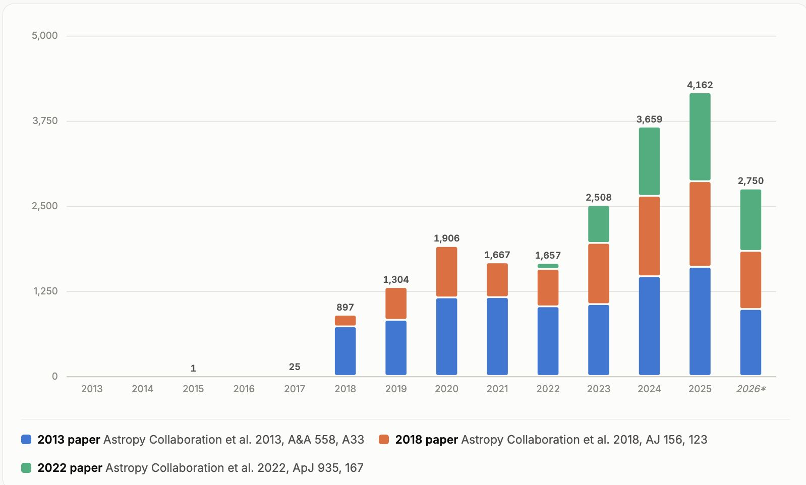
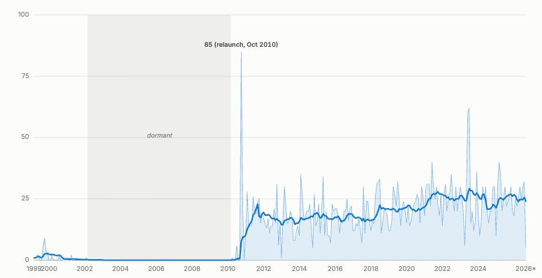
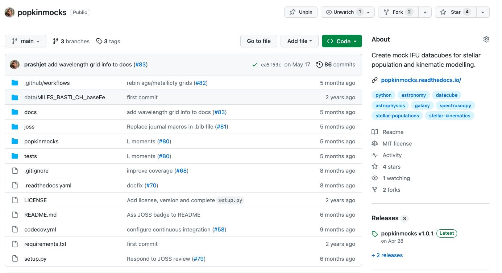
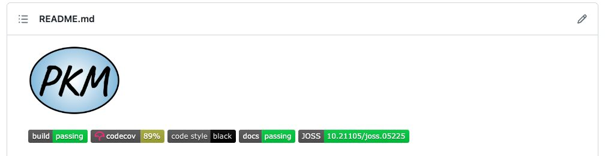

<!--
Migrated from "Lecture 01 (05_10).pdf".
Schedule slide below has been corrected per course-restructuring discussion:
Documentation now sits right after Environment & dependency management,
before Testing / Code quality (was: Testing, Code quality, Documentation).
-->

# Open Source Software Development for Astronomy

Prashin Jethwa
05/10/26

## Introduction round

1. Your name
2. Study level (PhD/MSc), research area
3. What's your experience with research code/software development?

## What is Open Source Software (OSS)?

What are the benefits of OSS?

## What is OSS? Why is it useful?

- Most astronomers have no formal education in programming. This causes code that:
  - doesn't work
  - is hard to understand
  - is hard for others to use (including yourself later down the line)
  - cannot produce reproducible results
- Open-source software (OSS):
  - software whose source code is publicly available, allowing users to use, study, modify, and distribute it
  - principles of open source lead to more reliable, reproducible and impactful research software
- This course will:
  - teach you **principles and tools** of open source software
  - enable you to develop an open-source package from the ground up

## OSS in astronomy

- [Astropy](https://www.astropy.org/)
  - A basic library for all astronomy/astrophysics
  - plus ~100 affiliated packages with specific scopes e.g.
    - photutils for photometry
    - specutils for spectroscopy
- [Astronomy Source Code Library](https://ascl.net/)
  - online registry and repository for source codes of interest to astronomers and astrophysicists
  - ~25 new additions per month
- Growing recognition of the importance of software & OSS:
  - dedicated sections in most astronomy white papers
  - credit for research software developers

## Who am I?

- Research:
  - Dark matter & galaxy assembly
  - Dynamics, stellar populations & kinematics
  - Local Group & nearby Universe
- My projects:
  - [DYNAMITE](https://github.com/dynamics-of-stellar-systems/dynamite): orbit-based modelling of galaxies
  - [Popkinmocks](https://github.com/prashjet/popkinmocks): mock IFU datacubes for stellar population and kinematics models of galaxies
  - [TNT](https://github.com/dynamics-of-stellar-systems/tnt): re-writing DYNAMITE using JAX i.e. a differentiable & GPU-accelerated framework (ongoing)
- Other software activities:
  - Contributions to other open-source software projects:
    - [blackjax](https://blackjax-devs.github.io/blackjax/), [numpyro](https://num.pyro.ai/en/stable/) (probabilistic programming languages)
    - [galax](https://github.com/GalacticDynamics/galax) (galactic dynamics in JAX)
  - Referee for Journal of Open Source Software
  - Built a network of colleagues with a focus on research software

## Anatomy of an Open Source Software (OSS) project

Demonstrated using [popkinmocks](https://github.com/prashjet/popkinmocks), annotated with:

- Continuous Integration
- git/GitHub
- Documentation
- Tests
- Packaging

## This course

- You will develop and publish your own software project
- Each lecture:
  - demonstration of a concept & associated *tool*
  - hands-on time for implementation
- Timetable: subject to change, any changes will be announced
- 25/01: final project presentations

| Date  | Topic                                                  |
|-------|---------------------------------------------------------|
| 05/10 | Intro                                                    |
| 12/10 | Discuss Project Ideas                                    |
| 19/10 | Version control & collaboration — *git/GitHub*           |
| 26/10 | *(hack session)*                                         |
| 02/11 | *(hack session)*                                         |
| 09/11 | Environment & dependency management — *uv*               |
| 16/11 | Documentation — *sphinx*                                 |
| 23/11 | Testing — *pytest*                                       |
| 30/11 | Code quality — *ruff, typing*                            |
| 07/12 | Continuous integration — *GitHub Actions*                 |
| 14/12 | Packaging: project structure & namespacing                |
| 21/12 | *(hack session)*                                         |
| 28/12 | *(hack session)*                                         |
| 04/01 | Publishing & citing a release                             |
| 11/01 | Community building                                        |
| 25/01 | Final Presentations                                       |

## Assessment

- To pass: attend >= 50% of lectures
- Grade based on:
  - Your software package (60%)
    - Based on a checklist of criteria for good OSS e.g.
      - is the documentation complete, well-structured, understandable?
      - does the software have automated tests?
      - etc.. full list to be provided
    - You're assessed on these criteria, not the functionality of the software itself
  - Final presentation (40%)
    - Demonstrate your software package
    - Describe the motivation, challenges or difficulties you encountered
    - Answer questions about the package and tools you used

## Your software project: what to pick?

- The choice is yours:
  - existing research code you'd like to package and publish
  - a new tool that would be useful for your research
    - e.g. automating a tedious, repetitive task
  - non research code: related to your hobby, a toy project etc…
- Examples:
  - [student projects from WS 2023](https://github.com/prashjet/oss4astro)
  - *Examples from Past Years* from [Code/Astro workshops](https://github.com/semaphoreP/codeastro)
- Think about the timescale constraints:
  - 3 ECTS ≈ 75 hours total = 18 hours lectures + 57 hours outside
  - Some time to develop projects in
    Some hands-on time in lectures, but mostly outside
- Assessment will be based on OSS criteria, not the content of the package

## AI Coding Agents

- Software development has transformed by AI
  - In research e.g. updated [submission criteria on the Journal of Open Source](https://blog.joss.theoj.org/2026/01/preparing-joss-for-a-generative-ai-future)
  - Outside of research: most industry software teams use coding agents by default
- This uses coding agents based on large language models, e.g.
  - Codex (OpenAI)
  - Claude Code (Anthropic)
- For this course:
  - I'll demonstrate the use of AI coding agents
  - You are allowed to use them
    - recommendation: do things manually on a first pass
    - final submission, you must describe your AI usage
  - You are not required to use them; they are not necessary

## Logistics

- Course [Moodle page](https://moodle.univie.ac.at/course/view.php?id=473822)
  - Resources and slides added as we go along
- Lecture attendance
  - > 50% attendance requirement, as recorded by sign-in sheet
  - to provide flexibility - if you know a lecture topic well, no obligation to turn up
  - no lectures on 26th Oct, 2nd Nov
- Bring laptops to lectures
- This course will introduce you to one set of tools
  - there's often many tools which do similar things e.g. [hypothesis vs pytest](https://python.libhunt.com/compare-pytest-vs-hypothesis)
  - you are free to use alternative tools, so long as you:
    - share and describe your choices in the class
    - justify your choices for the final project submission

## Preparatory tasks before next week

1. A [diagnostic assignment](https://colab.research.google.com/drive/1ZctFSkoE0uorM13Js-Djco09ve_7LOEh?usp=sharing) for your Python coding skills
2. Install the following software:
   - [git](https://git-scm.com/install/) (required)
   - [uv](https://docs.astral.sh/uv/getting-started/installation/) (required)
   - [Visual Studio Code](https://code.visualstudio.com/download?_exp_download=fb315fc982) (VS Code) text editor (optional/recommended)
3. Decide on a project idea
   - Fill in your idea on the course Moodle page
   - Next week, we'll discuss your project ideas together
