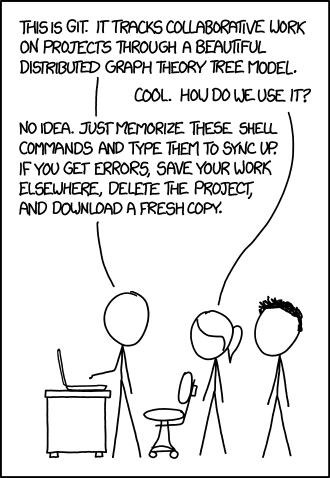
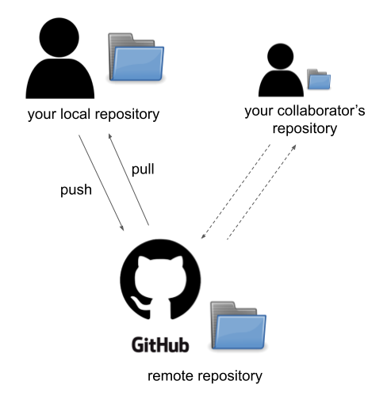
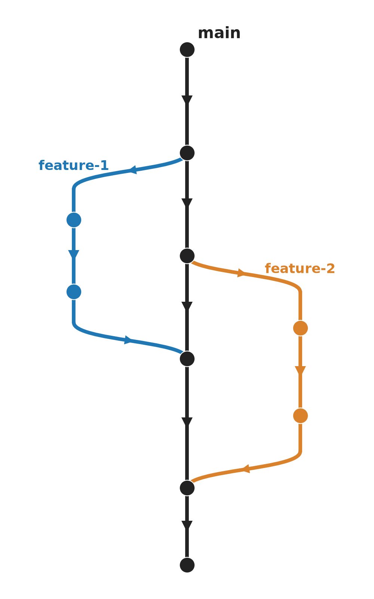
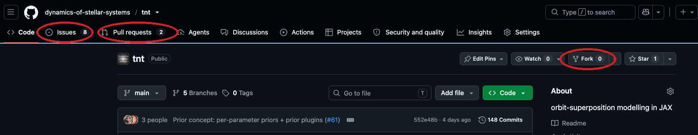

# Introduction to Git & GitHub

Prashin Jethwa
19/10/26

## Goals

After this lecture you should be able to:
- use git for version control,
- collaborate on open source projects using GitHub,
- use the git/GitHub integrations in VSCode.

## What is Version Control?

- the practice of controlling, organizing, and tracking different versions in history of source code
- this is useful for:
  - adding features in a systematic way,
  - reverting to older (working) versions of a codebase,
  - working collaboratively.
- some examples:
  - copy and re-name the entire folder, e.g.
    - `mycode` &rarr; `mycode_v2` &rarr; ... &rarr; `mycode_v5_update_3`
  - file synchronization software e.g. Dropbox, Google drive...
  - tools specifically for version control of source code e.g. Git, svn, mercurial

## What are Git and GitHub?

- Git is software for version control
  - it is open-source, originally developed by Linus Torvalds (creator of Linux)
  - it is a *distributed* version control system, i.e. the complete codebase (and full history) is mirrored on every developer's computer
- [GitHub](https://github.com/) is a software development platform
  - proprietary, owned by Microsoft
  - uses Git for distributed version control
  - adds additional features e.g. access control, continuous integration, wikis...

{.big-image}

*[xkcd.com/1597: Git](https://xkcd.com/1597/)*

## Git repositories

- Git *repository* (AKA *repo*) is the folder containing files to be tracked,
- the *remote repo* is hosted with GitHub,
- your *local repo* is hosted on your computer,
- you *push* changes to the remote repo,
- you *pull* changes from the remote repo,
- a *commit* is the basic unit of change that you can push/pull,
- multiple developers can work on the same repo simultaneously.

{.big-image}

## Branches

- Git *branches* provide a way for developers to:
  - work on new features without breaking the core code,
  - work on several features simultaneously,
  - multiple developers to work on the same repo
- basic workflow:
  - create branches off of the *main* where you add a new feature, fix a bug etc...
  - once your changes are complete, you *merge* the branch back into main
- *merge conflicts* arise if several branches change the same piece of code
  - Git will ask you to *resolve* conflicts before completing a merge

{.big-image}

*Branches in Git. Each circle represents a single commit*

## GitHub Pull Requests, Issues & Forks

- *pull requests* (PRs) are a way to organise merges within GitHub
- you *raise* a PR to request that your branch gets merged to main 
- when working in teams, there will often be discussion and iteration before a PR is merged

- GitHub *issues* is where to record changes that need implementing 
  - user-contributed bugs,
  - your own record of upcoming features,

- to contribute to someone else's repo, first create a *fork*
  - this is your copy of the repo where you can make changes
  - to get your changes into the *upstream* repository, you must raise a PR 

## Live Demo

Instructions to reproduce can be found [here](https://prashjet.github.io/oss4astro-course/lectures/02_intro_to_git/walkthrough.html).

## Project Requirements

- develop your project using Git & GitHub
- use branches and PRs when adding new features
  - do not merge directly to main!
  - keep individual PRs *well-scoped* i.e. as small as possible to implement a single new feature, fix a single bug etc...
- collaborate at least once via GitHub issues & PRs:
  - pick a partner in this class,
  - raise an issue in your repository describing some change you would like to make (keep it simple!)
  - invite a colleague from this class to address the issue,
  - to do this: fork your partner's repo, make the change, raise a PR