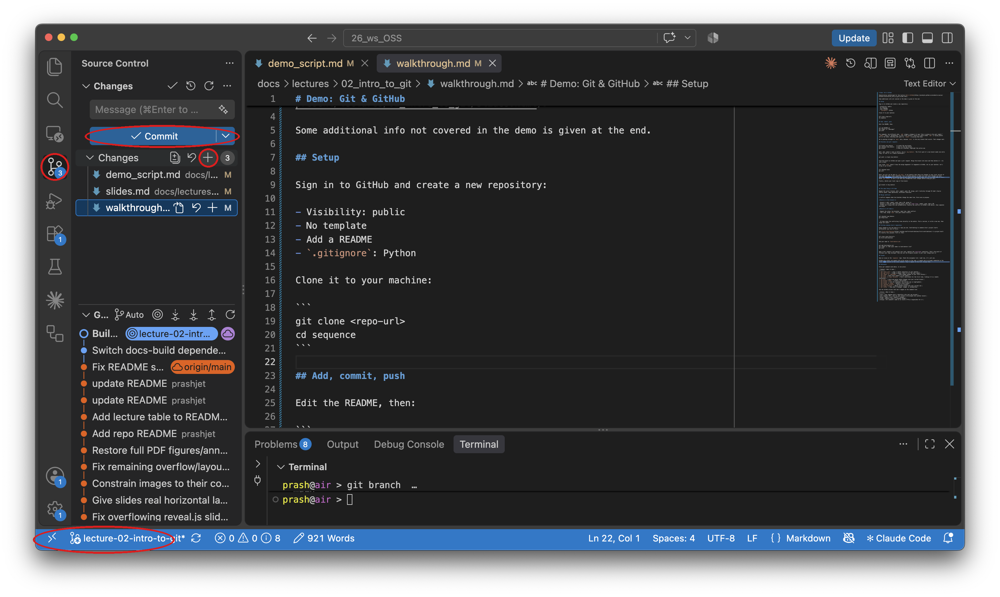
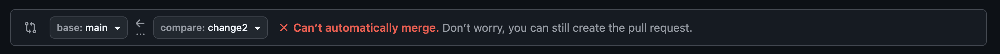
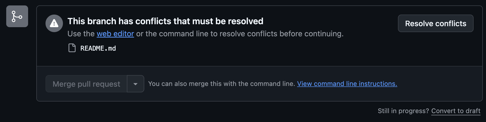
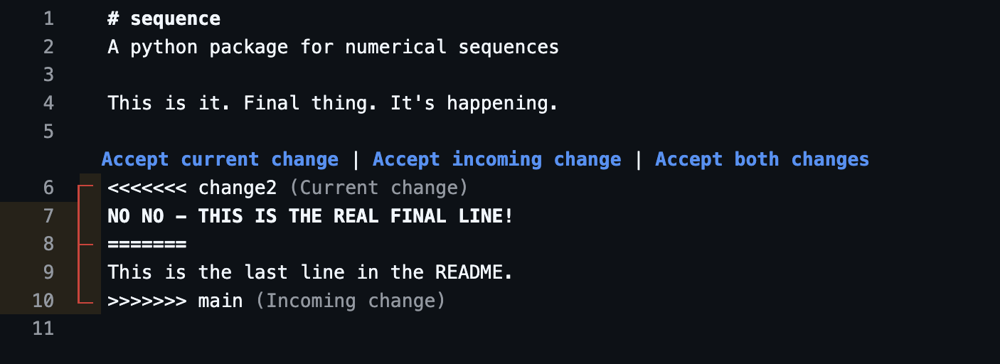
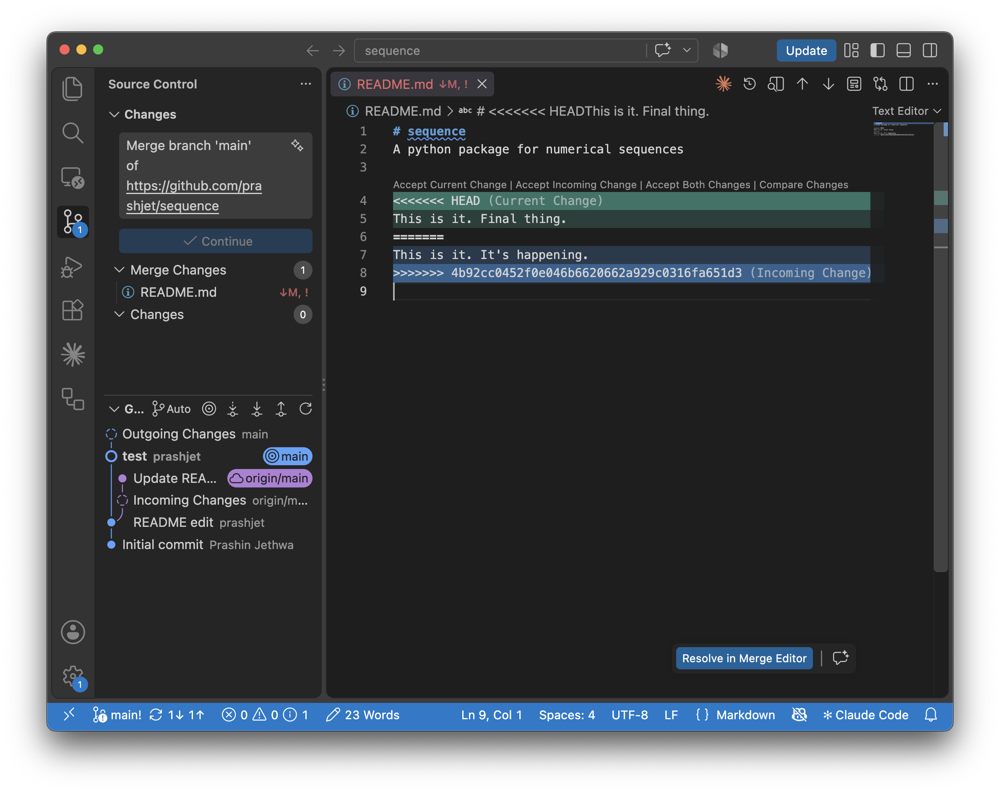

# Demo: Git & GitHub

Demonstration walkthrough for the lecture [Git & GitHub](https://prashjet.github.io/oss4astro-course/present/lectures/02_intro_to_git/slides.html).

## Setup

Sign in to GitHub and create a new repository. A few choices matter here, and you'll make them again for your own projects:

- **Visibility: public** — anyone can view, clone, and fork a public repo. Open-source work needs to be visible, so this is the default for most of what you'll do in this course. (Private repos restrict access to you and whoever you explicitly invite — the right call for anything not meant to be shared.)
- **No template** — templates pre-fill a repo with an existing project's structure. We're starting from nothing, so every piece of git appears as it happens, not hidden inside a scaffold someone else wrote.
- **Add a README** — this gives the repo an actual first commit on `main`, rather than a genuinely empty one. It's also just good practice: a README is the first thing anyone sees when they land on your project, and it's where you explain what it does.
- **`.gitignore`: Python** — a `.gitignore` tells git which files to never track: caches, build artifacts, virtual environments, anything generated rather than written by hand. GitHub's Python template pre-fills the usual suspects (`__pycache__`, `.venv`, ...) — worth having even though this particular demo repo barely touches Python.

Clone it to your machine to create your local repository:

```
git clone <repo-url>
cd sequence
```

## Add, commit, push

We'll now make some local changes and send them to the remote. Edit the README, then:

```
git add README.md
git commit -m "<message>"
git push
```

Two commands, two different jobs. `add` stages a change — it says "this is going in the next commit." `commit` saves it, permanently, to your local history. Think of a photo album: `add` is laying photos out on the table, deciding what goes in; `commit` is gluing them down.

We're pushing straight to `main` here, because `main` is the only branch that exists. That changes next.

## Branches and pull requests

```
git branch new_feature      # create the new branch
git checkout new_feature    # move to the new branch
git branch                  # show all branches, highlight the active one
```

Edit, add, commit — same as before, now on `new_feature`. The first push of a new branch needs one extra flag, to link it to a remote counterpart:

```
git push -u origin new_feature
```

Find the branch on GitHub and open a pull request. Merge the branch into main and then delete it - its job is done!

Your local `main` doesn't know the merge happened — it happened on GitHub, not on your machine. Let's bring it up to date:

```
git checkout main
git pull
```

Finally, delete your local copy of the branch:

```
git branch -d new_feature
```

## The same thing in VS Code

Let's repeat the cycle of branch, edit, commit, push entirely through VS Code's Source Control panel. These are the same git operations, just from a different interface.



## Un-committed code

Before we pull the remote changes into main, let's make a local change to the file. If we then try `git pull` 

```
error: Your local changes to the following files would be overwritten by merge:
        README.md
Please commit your changes or stash them before you merge.
Aborting
```

Here, git has detected that there are changes to your local version of the repo that haven't been committed, and is therefore preventing the `pull`. This is safety measure to make sure any local changes you have don't get accidently overwritten. It is always a good idea to run a quick `git status` to see if you have any uncommitted local changes before using git pull. Our options now are to either remove the uncommited changes or commit them before pulling.

## Merge Conflicts

Sometimes, there will be a conflict between an update to a file on the remote repo and an update to a file on your local machine. In that case, git isn't sure which change to keep, and a conflict is raised.

To manufacture a conflict, we will create two local branches (`change1` and `change2`), editing the README in both, then raise PRs to merge both into main. In the second PR we'll see the warning:



We can still create the PR, but before merging to main we have to resolve the conflict. We can do this in two different ways:

### 1. remotely: directly in GitHub 

GitHub provides an option to resolve the conflict in a web editor: 



The editor shows us the following conflict markers,



We now resolve the conflict by:
- editing the file by deciding which line of the conflict we want to keep (or combining them appropriately if we want to keep parts of both),
- deleting the extra lines added by Git which mark the conflict i.e., the HEAD, >>>, <<<<, and ==== markers,
- commit, mark the conflict as resolved, and complete the merge.

### 2. locally: merging `main` back into the feature branch 

Let's re-create the same conflict scenario with pull requests for two conflicting branches `change1` and `change2`. We merge `change1` into main, and again see that `change2` cannot be merged into main. This time, we'll resolve the conflict locally, by

```
git checkout main       
git pull                # get local main up to date with remote
git checkout change2
git merge main          # merge the local main into local `change2` branch
```

The conflict markers and options for how to resolve them look similar in VSCode:



We resolve the conflict the same way as before, then commit, push, and merge the PR on GitHub.

### Conflicts arising from `git pull`

If a remote branch and a local branch have diverged, pulling the remote branch via `git pull` may also provoke a conflict. The first time you run into this, you will see the message like:

```
From https://github.com/prashjet/sequence
 * branch            main       -> FETCH_HEAD
hint: You have divergent branches and need to specify how to reconcile them.
hint: You can do so by running one of the following commands sometime before
hint: your next pull:
hint: 
hint:   git config pull.rebase false  # merge
hint:   git config pull.rebase true   # rebase
hint:   git config pull.ff only       # fast-forward only
hint: 
hint: You can replace "git config" with "git config --global" to set a default
hint: preference for all repositories. You can also pass --rebase, --no-rebase,
hint: or --ff-only on the command line to override the configured default per
hint: invocation.
```

You should choose the first option given in the hints, i.e. run

```
git config pull.rebase false
```

This tells `git pull` to resolve divergences by merging - i.e. as we did in both examples above - rather than rebasing or fast-forwarding, which are other git commands we can ignore for the time being. After setting that config option, in case with conflicts, `git pull` will trigger a merge, which can be completed as in the cases above.

## Contributing to other open-source projects

Every change so far has been to your own project, where you have permission to write directly to main. When contributing to someone else's project, this isn't possible. Your changes have to go through a PR and be accepted by the project owners.

The process to raise a PR for an external project is mostly similar to above, with one difference. You start by *forking* the repository, which creates a local version where the *upstream* repository is marked as the relevant place to direct your PRs. 

[first-contributions](https://github.com/firstcontributions/first-contributions) is a simple open-source project built just to demonstrate this - check it out and follow the instructions there to make your first open-source contribution. 

## Issues

GitHub issues is a convenient place to record any future changes that need to be incorporated into the code base e.g. bugs, missing features etc. You can *assign* an issue to be resolved by anyone who:
- is a collaborator on your repository (GitHub → Settings → Collaborators),
- has commented on the issue.

## GitHub credentials

Cloning a public repo needs no authentication, but `git push` (or cloning a private repo) does. If you haven't set anything up, you'll be prompted for credentials, and typing your actual GitHub password will fail with:

```
Username for 'https://github.com': <your username>
Password for 'https://<username>@github.com': <your password>
remote: Support for password authentication was removed on August 13, 2021.
remote: Please see https://docs.github.com/en/get-started/getting-started-with-git/about-remote-repositories#cloning-with-https-urls for information on currently recommended modes of authentication.
fatal: Authentication failed for 'https://github.com/<user>/<repo>.git/'
```

You can set up your credentials by installing the [GitHub CLI](https://cli.github.com/) then running

```
gh auth login
```

Follow the prompts — choose GitHub.com, HTTPS, and "Login with a web browser." A one-time code appears in your terminal; paste it into the browser tab that opens, and approve the login. From then on, `git clone`, `git push`, and `git pull` all authenticate automatically, from the terminal or from VS Code — no password, no token to copy around.

This only needs doing once per machine.

## Summary of git/GitHub commands

A summary of all the git command used above:

| Command | What it does |
|---|---|
| `git clone <url>` | Copy a remote repository to your machine |
| `git add <file>` | Stage a change — mark it for the next commit |
| `git commit -m "<message>"` | Save staged changes to your local history |
| `git push` | Send local commits to the remote |
| `git push -u origin <branch>` | Push a new branch for the first time, linking it to a remote counterpart |
| `git pull` | Fetch and merge remote changes into your current branch |
| `git branch <name>` | Create a new branch |
| `git branch` | List all branches; the current one is highlighted |
| `git branch -d <name>` | Delete a local branch |
| `git checkout <branch>` | Switch to a branch |
| `git merge <branch>` | Merge another branch into your current one |
| `git status` | Show what's changed, staged, or uncommitted |

And the GitHub actions that don't happen on the command line:

| Action | What it does |
|---|---|
| Fork | Copy someone else's repository into your own account |
| Pull request (PR) | Ask for your branch to be merged into another branch |
| Merge | Apply a pull request's changes |
| Issue | Record a bug or a planned change |
| Assign | Put someone's name on an issue or PR as responsible for it |

## Other References

[GitHub's pull request and collaboration guide](https://docs.github.com/en/pull-requests) — creating, reviewing and merging PRs, resolving conflicts, working with forks.